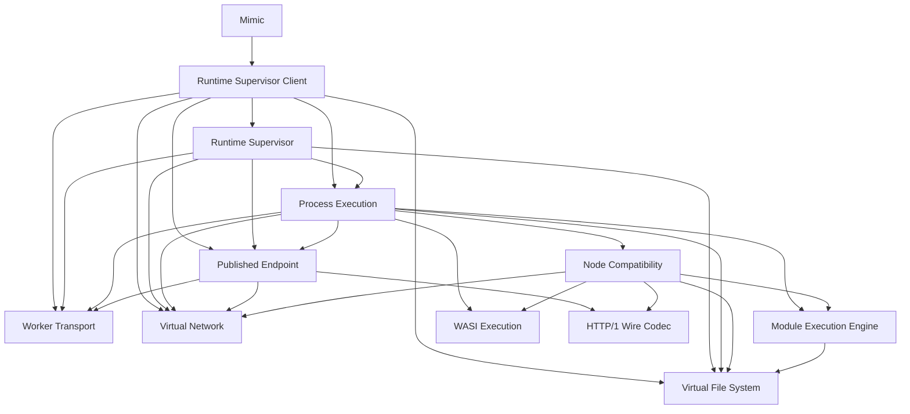

# Enforce the Headless Runtime Core as deep modules

ADR-0015 supersedes this target decomposition. This document and its
machine-readable registry remain the enforced migration baseline until the
final Runtime Host cutover (#628)
moves the Architecture Gate to ADR-0015.

Mimic will be rebuilt as a closed, headless runtime composed from responsibility-owned deep modules rather than a flat runtime cluster or a public plugin system. This preserves one authoritative runtime epoch, keeps Node and browser details at adapters, and lets repository tooling reject architectural drift instead of relying on agent memory.

## Public interface

`Mimic` remains the single public facade. It exposes only its read-only `workdir`, filesystem handle, Published Endpoints, `spawn`, and `teardown`; runtime modules and their composition seams remain package-internal. `boot` accepts only an optional absolute `workdir`: cross-origin isolation is mandatory, cache and browser adapters are internal, and Execution Capacity is runtime-owned policy rather than public scheduler tuning.

The runtime is distributed as one public installable package. Deep modules may use internal workspace packages to enforce ownership and build boundaries, but they are not independently published, user-composed, or exposed as a plugin surface. Worker, Service Worker, bootstrap, and compiled runtime assets are version-matched parts of that package and are verified through a clean external consumer.

A `MimicProcess` exposes its PID, separate binary `stdin`, `stdout`, and `stderr` streams, `kill`, and a numeric exit promise. The exit promise resolves only after stream closure and process cleanup; a runtime or transport crash without an honest process exit code rejects with a structured process-crash error. `Mimic.teardown()` is asynchronous and idempotent, rejects new operations immediately, drains or terminates owned work, closes transport and endpoint state, and resolves only when the runtime epoch owns no live resources.

`Mimic` remains a temporal singleton matching the official StackBlitz contract: at most one runtime epoch may be live on a page, and another boot is allowed only after the active instance's asynchronous `teardown()` resolves. Concurrent instances and the page-level worker, routing, and artifact coordination they require are outside this architecture effort; [the supporting research](../research/multiple-mimic-instances.md) records their feasibility for a separate future decision.

## Module ownership

- **Runtime Supervisor** is the sole authority and composition root for one runtime epoch. Execution Context bootstraps are subordinate realm-local assemblies with no shared policy or authority.
- **Runtime Supervisor Client** may host package-owned main-thread execution
  adapters selected by Supervisor-owned Runtime Programs. Those adapters own no
  registration or resolution policy for migrated programs, admission,
  lifecycle authority, or fallback path; they only project browser Worker,
  stream, and endpoint-host capabilities across the transport boundary. The
  WASI Runtime Program adapter invokes the WASI Execution command interface
  after Process Execution has admitted a classified executable. The
  client imports the Runtime Supervisor entry point to construct the paired
  browser-side epoch composition; it does not import package installation,
  toolchain, catalog, or cache owners directly.
- **Process Execution** owns program resolution, `spawn` admission, identity-preserving admitted program replacement, the process tree, Execution Capacity, private worker bootstrap and Shell Runtime Program construction, stdio, signals, exit, and cleanup.
- **Virtual File System** owns one authoritative state, revisions, transactions, watchers, and tier-specific clients. Public filesystem, Node filesystem, synchronous mailboxes, and transaction-scoped views are adapters over this module rather than separate authorities. (Superseded: transactions and transaction-scoped views are removed by [ADR-0022](./0022-remove-vfs-transactions.md).)
- **Virtual Network** owns protocol-neutral virtual addresses, listeners, connections, and duplex byte streams.
- **Published Endpoint** depends on Virtual Network and owns stable browser URLs, route lifecycle, logical-origin cookies, and host protocols. Virtual Network never depends on publication.
- **Module Execution Engine** owns resolution, loading, compilation, the Module Registry, CJS/ESM interop, and its private Runtime Artifact Compiler. It owns the `BuiltinModuleProvider` and `ModuleAccess` ports but never imports Node Compatibility.
- **Node Compatibility** is local to each Execution Context. It implements the engine-owned builtin port, installs Node globals, and adapts VFS, network, and process clients into Node-shaped behavior.
- **WASI Execution** owns supported ABI admission, instance lifecycle, descriptor state, and syscall semantics. Node Compatibility projects `node:wasi` as a thin Node-shaped adapter over its package-internal entry point; Process Execution does not own WASI syscalls.
- **Process Execution** constructs its Node, Shell, WASI, and manager-specific
  Command Proxy Runtime Programs; WASI executable inspection remains delegated
  to WASI Execution. Catalog selection and verified artifact acquisition are
  private beneath the Command Proxies.
- **Worker Transport** alone owns browser messaging primitives and generic correlation, cancellation, backpressure, serialization, versioning, and cleanup. Each domain module owns its protocol messages, clients, handlers, and versions.
- **HTTP/1 Wire Codec** is the named shared protocol module used by Node HTTP adapters and Published Endpoint. Virtual Network remains unaware of HTTP.
- Browser workers, Service Worker hosting, persistence, and outbound transports are package-owned adapters at module-owned seams. Applications cannot inject a replacement runtime composition.

Package Installation and Package Execution are observable behaviors implemented
by upstream manager child Runtime Processes and Process Execution Command
Proxies, not separate modules or process paths. Caches, errors, lifecycle resources, protocol types, and value types remain with their owning modules; there is no global cache, event bus, cleanup registry, capability bag, `types`, `utils`, or `common` module.

## Dependency contract

Arrows mean that the source module on the left may import the entry-point interface on the right. Runtime Supervisor imports implementations only to compose them. Runtime Supervisor Client is the sole module allowed to import the Supervisor entry point, and only to construct the paired browser-side epoch composition; domain modules do not import Runtime Supervisor.



The Architecture Gate treats the following JSON as the canonical machine-readable snapshot of this dependency graph. The gate rejects any registry that differs from it.

<!-- architecture-gate:runtime-deep-modules:start -->
```json
{
  "mimic": ["runtime-supervisor-client"],
  "runtime-supervisor-client": ["runtime-supervisor", "process-execution", "worker-transport", "virtual-file-system", "virtual-network", "published-endpoint"],
  "runtime-supervisor": ["process-execution", "virtual-file-system", "virtual-network", "published-endpoint", "worker-transport"],
  "process-execution": ["module-execution-engine", "node-compatibility", "published-endpoint", "virtual-file-system", "virtual-network", "wasi-execution", "worker-transport"],
  "published-endpoint": ["virtual-network", "http-1-wire-codec", "worker-transport"],
  "node-compatibility": ["module-execution-engine", "wasi-execution", "virtual-file-system", "virtual-network", "http-1-wire-codec"],
  "module-execution-engine": ["virtual-file-system"],
  "virtual-file-system": ["worker-transport"],
  "virtual-network": [],
  "worker-transport": [],
  "http-1-wire-codec": [],
  "wasi-execution": []
}
```
<!-- architecture-gate:runtime-deep-modules:end -->

Node-shaped errors are created only by Node Compatibility adapters. Domain modules return structured domain errors, and Worker Transport preserves their typed data without translating semantics.

## Enforcement

Each deep module has one entry point and hides its implementation. Cross-module code and maintained behavioral tests import only entry points. The migration must establish dependency-cruiser enforcement as its first blocking tracer bullet, reject forbidden imports and cycles without exception rules, and require the architecture check in every implementation issue. Agent instructions route runtime architecture and migration work through this ADR.

The Architecture Gate reserves Preview1 syscall-table markers to WASI Execution across every registered Runtime Deep Module. Node Compatibility and Process Execution may depend on role-specific entry-point interfaces, but cannot own or duplicate syscall implementations.

Wide cutovers use an explicit expand-migrate-contract sequence. A temporary Migration Bridge must be package-agnostic, have one owner, reject new callers through an automated guard, and name a blocking deletion issue. A capability group cannot close while its bridge, legacy authority, compatibility shim, or dual path remains.

## Considered options

- Keep the current flat `src/runtime` import graph and rely on review.
- Publish a runtime plugin system and let applications compose modules.
- Add a reusable `BrowserPlatform`, runtime capability bag, or shared utilities layer.
- Branch generic Process Execution admission or lifecycle code on package-manager commands.

These options were rejected because they expose implementation knowledge to callers, create cycles or package-specific generic paths, and cannot protect the target architecture from incremental drift.
