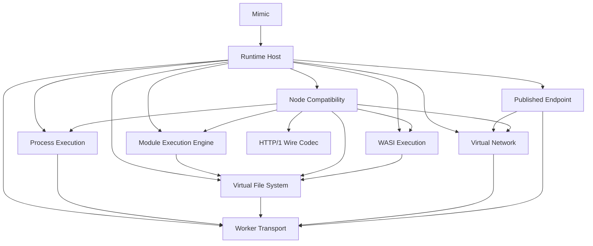

# Simplify the Mimic runtime architecture

Mimic keeps its public headless contract but replaces the current
sixteen top-level runtime modules with ten deep responsibility owners. This
supersedes ADR-0003 because its Supervisor/Client split, Execution Context
Bootstrap, Browser Adapters, Shell, Package Installation, and compound
Toolchain/Catalog/Artifact Cache modules expose placement and workflow details
as peer authorities.

## Responsibility owners

- **Runtime Host** owns one runtime epoch, composition, fatal failure, and teardown.
  Process Execution and every Runtime Program run in its worker, which creates
  the process workers; the page keeps only the public facade, Service Worker
  registration and the published-document bridge
  ([ADR-0020](./0020-run-runtime-programs-in-the-runtime-host-worker.md)).
- **Process Execution** owns command resolution, admission, processes, private
  worker bootstrap, Runtime Programs, capacity, stdio, signals, exit, and cleanup.
- **Virtual File System** owns the inode/namespace authority, Open File
  Descriptions, atomic mutation, watches, persistence, and its
  direct asynchronous and synchronous projections. It keeps one mutable state;
  VFS Transactions are removed
  ([ADR-0022](./0022-remove-vfs-transactions.md)).
- **Virtual Network** owns runtime-local byte streams and listeners only.
- **Published Endpoint** owns browser publication, including Service Worker
  routing, URL identity, cookies, documents, WebSockets, and invalidation. It
  delivers a published request to the listener's `http.Server` as a structured
  request (method, target, headers, body stream) and receives the response the
  same way; it frames and parses no HTTP/1
  ([ADR-0024](./0024-deliver-published-http-as-structured-requests.md)).
- **HTTP/1 Wire Codec** owns the package's one HTTP/1 byte framing, used by
  Node Compatibility for HTTP carried over `node:net` connections and for the
  head a program writes on a socket handed over after `upgrade`.
- **Worker Transport** owns generic browser messaging mechanics, never domain
  messages or policy. Its mechanism is one typed RPC, defined by
  [ADR-0019](./0019-express-cross-context-calls-as-one-typed-rpc.md), which
  also drives an interface served in the calling context (ADR-0020), and its
  synchronous counterpart, the one channel through which a worker blocks
  until another context answers
  ([ADR-0025](./0025-use-one-synchronous-channel.md)).
- **Module Execution Engine** owns resolution, the single Module Registry,
  compilation, linking and evaluation. Its transformer is Babel, run once per
  distinct source in the Runtime Host's compiler pool and kept in the Compile
  Cache ([ADR-0023](./0023-compile-once-with-babel-and-a-shared-compile-cache.md)).
- **Node Compatibility** owns one context-local lazy builtin table, Node
  semantic cores, globals, and explicit adapters over runtime capabilities.
- **WASI Execution** owns the supported WASI ABI host used by both a Runtime
  Program and the private `node:wasi` adapter.

Shell and manager-specific Command Proxies are private Runtime Program
implementations under Process Execution, not additional deep modules. One
table of Runtime Programs and one executable resolver serve every context. The
Browser Package Replacements are one small map, and the pinned CLIs, verified
artifact acquisition and the bounded Package Artifact Cache are private
implementation beneath the Command Proxies
([ADR-0021](./0021-reduce-package-management-to-a-pinned-cli-and-a-replacement-map.md)).

## Dependency contract

Runtime Host may import owner implementations only to compose one epoch.
Owner-to-owner imports use the callee's entry point; role ports are owned by
their consumer so the graph remains acyclic.



The Architecture Gate will treat the following JSON as its canonical target
after the final Runtime Host cutover:

<!-- architecture-gate:runtime-deep-modules:start -->
```json
{
  "mimic": ["runtime-host"],
  "runtime-host": ["process-execution", "virtual-file-system", "virtual-network", "published-endpoint", "worker-transport", "module-execution-engine", "node-compatibility", "wasi-execution"],
  "process-execution": ["worker-transport"],
  "virtual-file-system": ["worker-transport"],
  "virtual-network": ["worker-transport"],
  "published-endpoint": ["virtual-network", "worker-transport"],
  "http-1-wire-codec": [],
  "worker-transport": [],
  "module-execution-engine": ["virtual-file-system"],
  "node-compatibility": ["module-execution-engine", "wasi-execution", "virtual-file-system", "virtual-network", "process-execution", "http-1-wire-codec"],
  "wasi-execution": ["virtual-file-system"]
}
```
<!-- architecture-gate:runtime-deep-modules:end -->

[ADR-0029](./0029-move-runtime-behaviour-to-its-owner-and-keep-the-module-graph-in-documents.md)
removes the Architecture Gate. The graph above stays the documented contract,
with the edge and ownership corrections ADR-0029 records, and is upheld in
code review rather than by repository tooling.

## Interface and migration policy

Each owner exposes only construction, caller-specific handles, and domain
values or errors that cross a real seam. Concrete classes, validators, worker
bootstrap, protocol maps, caches, and test projections remain private.
Validation occurs once at trust boundaries; same-build protocol versions,
identity mappings, defensive freeze chains, one-implementation interfaces, and
generated client/server families are deleted.

The migration is delivered by target owner through expand-migrate-contract
slices. A temporary Migration Bridge is allowed only between consecutive
slices, with one owner, a no-new-callers guard, and a native blocker for its
deletion. The current ADR-0003 registry remains the executable baseline until
the final Runtime Host slice (#628)
atomically updates the registry, checker, tests, and all remaining callers to
this ADR. The complete implementation graph is the native child/dependency
topology under Simplify runtime modules behind the Mimic contract (#616).

## Compatibility contract

The public `Mimic` seam and every maintained Compatibility Claim
remain protected. Internal behavior without a public contract, production
caller, maintained claim, or independently valuable invariant is deleted
without manufacturing characterization tests. A changed invariant that can
escape the Compatibility Evidence Matrix receives one focused witness at the
owning entry point; the complete matrix remains the final integration gate.
