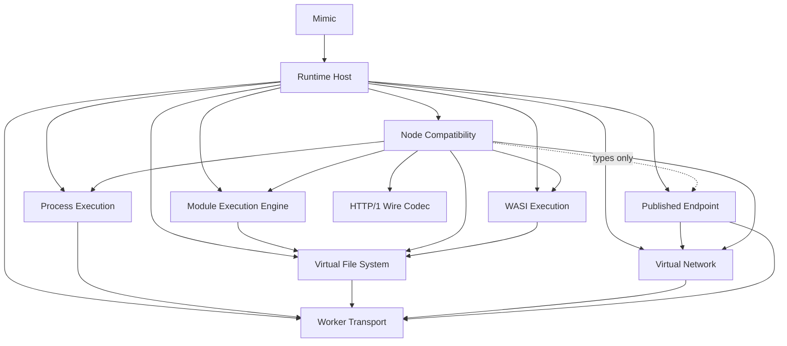

# Move runtime behaviour to its owner and keep the module graph in documents

ADR-0015 split the runtime into ten Runtime Deep Modules and fixed the
dependency edges between them. An audit of the package on 2026-10-06 found that
the edges are respected everywhere: no import bypasses an entry point, there
are no cycles, no state is shared through `globalThis`, and the three generic
owners (Worker Transport, Virtual Network, HTTP/1 Wire Codec) carry no domain
knowledge. What the graph did not protect is ownership. To satisfy the edges,
behaviour moved to the one module allowed to import everyone, Runtime Host, or
was written twice on both sides of a forbidden edge. This ADR records those
findings, decides where each piece belongs, and replaces the tooling that
enforced the graph with the graph itself as a document.

## Findings

Line numbers are those of the audited revision (`ce4487b`).

### Runtime Host carries domain behaviour

ADR-0015 gives Runtime Host "one runtime epoch, composition, fatal failure,
and teardown". Of its 6,033 lines about 2,000 are that (`runtime-host.ts`,
`worker-epoch.ts`, `worker.ts`, `runtime-assets.ts`, the two protocol files,
the compiler pool). The rest implements other owners' responsibilities:

- `node-runtime-program.ts` (698 lines) is `NodeCommand`: the `process`
  object, uncaught-exception and unhandled-rejection policy, the `beforeExit`
  loop, the Node global object, the file-watch lifecycle. This is Node
  Compatibility.
- `runtime-program-host.ts` (1,091 lines) binds programs, wires spawn and
  `exec` replacement, maps signals to exit codes, relays child stdio and holds
  four `ProcessInput` implementations. ADR-0015 assigns stdio, signals and
  exit to Process Execution.
- `node-process-worker.ts` (799 lines) mixes the process-worker bootstrap, a
  child-stdio client, a stdin buffer and the published-listener server with
  its WebSocket framing.
- `runtime-program-registry.ts` holds `runtimeProgramDefinitions`, the one
  table of Runtime Programs that CONTEXT.md and ADR-0015 place in Process
  Execution. It is assembled from five sources (`SHELL_PROGRAM_COMMANDS`,
  `NODE_PROGRAM_COMMANDS`, `coreUtilityDefinitions`,
  `packageManagerRuntimeProgramDefinitions()`,
  `WASI_PREVIEW1_RUNTIME_PROGRAM_ID`), and the `sh` and `node` commands are
  written out a second time in `runtimeProgramResolution`.
- `worker-thread-ports.ts` and `process-worker-threads.ts` implement the
  Worker Thread Port Relay and the `ThreadExecutionPort`, Node
  `worker_threads` semantics.
- `execution-context-runtime.ts:309-322` parses `NODE_OPTIONS` a second time
  beside `parseNodeCommandLine`.

The cause is the graph: Process Execution may import only Worker Transport, so
the JavaScript program that needs the Module Execution Engine and Node
Compatibility could not live there and landed in Runtime Host. Node
Compatibility, however, may import both the Module Execution Engine and
Process Execution, so most of this code can move there without a new edge.

### One contract, two definitions

Three contracts exist as structural duplicates on both sides of a forbidden
edge, reconciled only by TypeScript's structural typing:

| Contract | Copy A | Copy B | Meet at |
| --- | --- | --- | --- |
| Child-process port (`ChildProcessExecutionPort` and ten related types) | `process-execution/adapter-ports.ts:2-85` | `node-compatibility/child-process.ts:6-85` | `runtime-host/execution-context-runtime.ts:148` |
| Published HTTP Exchange (`PublishedEndpointServer` and five related types) | `published-endpoint/types.ts:91-130` | `node-compatibility/http.ts:73-110` (`HttpListener`) | `runtime-host/node-runtime-program.ts:326` |
| `ThreadIdentity` | `process-execution/adapter-ports.ts:88` | `node-compatibility/worker-threads.ts:13` | same |

Runtime Host implements the Process Execution copy of the child-process port
while Node Compatibility consumes its own, so the port has two owners and the
"role ports are owned by their consumer" rule of ADR-0015 is not met.

### Values parked in the wrong module

- The `worker_threads` shared-memory pool: every reader and writer of the
  layout is in `node-compatibility/worker-threads.ts:191-220`, while the
  layout constants and the factory are exported from
  `process-execution/worker-thread-shared-memory.ts`, which Process Execution
  never uses itself.
- `VIRTUAL_PLATFORM` (`process-execution/runtime-platform-profile.ts`): Node
  identity consumed only by Node Compatibility and Runtime Host.
- `createReferencedChildProcessExecutionPort` and
  `createExecutionContextProcessProjection` (`process-execution/adapter-ports.ts`):
  Node event-loop `ref`/`unref` adapters with no caller in Process Execution.

### Duplicated algorithms

- Path normalisation is written four times: `virtual-file-system/path.ts`,
  `module-execution-engine/module-resolution-path.ts` (a verbatim copy over an
  allowed edge), `process-execution/posix-path.ts` (the one copy the graph
  forces), `node-compatibility/filesystem-shared.ts:46-75` (beside `url.ts`,
  which imports the original).
- The VFS Commit Journal is walked by two independent caches with different
  semantics for the `directory` scope:
  `module-execution-engine/module-resolution-cache.ts:87-158` and
  `virtual-file-system/mailbox-client-cache.ts`. Each Node process worker
  reads the same journal twice.
- Signal to exit code (130/137/143) appears seven times across Runtime Host
  and Process Execution.
- Error serialisation (`serializeRuntimeHostError`, `serializeExecutionError`,
  three `normalizeError`) is repeated inside Runtime Host while Worker
  Transport already serialises errors for every RPC.
- The VFS to `WasiSynchronousVfsPort` adapter is written in
  `runtime-host/execution-context-runtime.ts:282-307` and again in
  `runtime-host/wasi-runtime-worker.ts:44-65`.

### Contracts that are inferred rather than named

`NodeCompatibilityOptions.builtinOptions` is typed as
`Parameters<typeof createBuiltinTable>[0]`, itself assembled from
`Parameters<typeof createChildProcessBuiltin>[0]` and its siblings. Runtime
Host writes an intersection of three types for the single `process` field
(`execution-context-bootstrap.ts:14-26`). A change to any builtin factory's
signature changes the module's contract without touching the entry point.

`CommonJsModuleRecord = ModuleRecord`, so `node-compatibility/module-builtin.ts`
sees the registry's mutable `state`, `promise` and `children`.

### Entry points wider than their seams

Names exported from an `index.ts` and used by no other production module:
42 of 99 in Process Execution, 44 of 64 in the Virtual File System, 26 of 38
in Published Endpoint, 24 of 54 in the Module Execution Engine, 20 of 48 in
Node Compatibility. They include the concrete `VirtualFileSystem` class,
`createVirtualFileSystemAuthority`, the archive codecs, `resolveExecutable`,
`createVirtualProcess`, `ModuleRecord` and `ModuleRecordState`. Most exist so
that `tests/unit` can import them through the entry point, which the
Architecture Gate demanded of maintained tests.

### Hidden string contracts

- The `published-endpoint:websocket-*` envelope is typed in
  `published-endpoint/document-websocket-program.ts` and repeated as untyped
  literals in `runtime-host/published-listener.ts` and
  `runtime-host/node-process-worker.ts`.
- The Service Worker token is written in `published-endpoint/service.ts:9`
  and again in `service-worker-program.js:2`.
- `toNodeChildProcessError` recognises `EXECUTABLE_NOT_FOUND` by a message
  prefix; `runtime-program-host.ts:308` rethrows by an error-name prefix; the
  process-exit brand is recognised independently in
  `runtime-host/process-exit.ts` and `node-compatibility/worker-threads.ts:470`.
- The generated `published-endpoint/service-worker.js` is committed, rebuilt
  only by `build:package`, and no test checks that it equals
  `service-worker-program.js` plus the embedded transport.

## Decision

### Ownership

1. **Node Compatibility owns the Node program.** `NodeCommand`, the execution
   context bootstrap, `NODE_OPTIONS` parsing, the Node global object, the
   Worker Thread Port Relay and `ThreadExecutionPort`, the `worker_threads`
   shared-memory pool, `VIRTUAL_PLATFORM` and the event-loop `ref`/`unref`
   adapters move from Runtime Host and Process Execution into Node
   Compatibility. Node Compatibility exposes one factory for the program that
   runs inside a process worker and one named capabilities interface (below).
2. **Process Execution owns the program table, stdio and exit.**
   `runtimeProgramDefinitions`, `runtimeProgramResolution`, the `ProcessInput`
   implementations, the sequence and drain-ack stdin protocol, child-output
   forwarding, the signal-to-exit-code mapping and the host side of the
   process-worker stdio protocol move into Process Execution. Its entry point
   becomes one constructor that takes the externally implemented programs
   (`node`, the WASI inspector) as injected definitions and builds the one
   table from them plus its private shell, core utilities and Command Proxies.
   Shell internals, core-utility internals, executable resolution and
   `createRuntimeProgramRegistry` become private.
3. **Runtime Host keeps composition only**: epoch lifetime, worker creation,
   the page and host-worker protocols, the compiler pool and Compile Cache
   store, fatal failure and teardown. A file in Runtime Host that implements
   a `node:*` semantic, a stdio frame or a program is in the wrong module.

### Single owner for every contract

4. **The child-process port is owned by Node Compatibility**, its consumer.
   The copy in `process-execution/adapter-ports.ts` is deleted; Process
   Execution keeps only the request, signal, stdio and synchronous-result
   values it produces, and Runtime Host implements Node Compatibility's port
   type.
5. **The Published HTTP Exchange is owned by Published Endpoint**, the caller
   that drives it. Node Compatibility's `HttpExchange*` and `HttpListener`
   types are deleted and `http.ts` implements `PublishedEndpointServer`
   directly. This adds one type-only edge, Node Compatibility → Published
   Endpoint, to the graph below.
6. **`ThreadIdentity`** has one definition, in Process Execution, whose
   `RuntimeExecutionContext.admitThread` accepts it; Node Compatibility imports
   it.
7. **Node Compatibility's contract is a named interface**,
   `NodeCompatibilityCapabilities`, listing every port it needs from the
   runtime (file system, network, child processes, threads, listener claims,
   macrotask scheduling, module access, script evaluation). `Parameters<typeof
   …>` chains across the entry point are not a contract.
8. **Module records stay private.** `CommonJsExtensionHandler` receives a
   read-only view (`filename`, `exports`, `loaded`, `paths`); `ModuleRecord`
   and `ModuleRecordState` leave the entry point.

### One algorithm per fact

9. The Module Execution Engine and Node Compatibility import the Virtual File
   System's path helpers. Process Execution keeps `posix-path.ts` as the one
   documented copy, because its only allowed dependency is Worker Transport.
10. The Virtual File System exports its commit-journal invalidation index as
    one primitive; the module-resolution cache and the mailbox-client cache
    both use it, so the `path`, `directory` and `subtree` scopes have one
    meaning.
11. Worker Transport exports its error serialisation; Runtime Host's copies go.
12. Signal to exit code is one exported function of Process Execution.
13. The WebSocket envelope, the Service Worker token and the process-exit
    brand each have one typed definition in their owner, imported wherever
    they are read. Errors are recognised by code, never by a message or name
    prefix.
14. The generated `service-worker.js` is either built on every `build` and
    `dev` from `service-worker-program.js`, or one unit test asserts the
    committed file equals the program plus the embedded transport.

### Entry points

15. An `index.ts` exports what another production module imports. Tests
    import the file they test by its path. The dead exports listed in the
    findings are removed from the entry points; those that exist only for a
    test are imported directly by that test.

### The Runtime Module Graph is a document

16. **The Architecture Gate is removed**: `dependency-cruiser` and its
    configuration, `architecture/runtime-deep-modules.cjs`,
    `architecture/runtime-source-ownership.cjs`,
    `architecture/runtime-dynamic-loads.cjs`, the two checker scripts, the
    `architecture:check` scripts and CI step, and the gate's fixtures and
    tests. The module list, entry-point rule and dependency edges below are
    the contract; a pull request that adds an edge updates this ADR in the
    same change, and review upholds it. CONTEXT.md names this the Runtime
    Module Graph.
17. The exclusive ownership of WASI preview1 syscall names by WASI Execution
    and the restriction of computed module loads to the Runtime Artifact
    Compiler remain rules of ADR-0015 and ADR-0023; they are no longer
    tool-checked.

## Runtime Module Graph

The graph of ADR-0015 with the one type-only edge of decision 5.

| Module | May import |
| --- | --- |
| `mimic` (`src/runtime/index.ts`) | `runtime-host` |
| `runtime-host` | every module, to compose one epoch |
| `process-execution` | `worker-transport` |
| `virtual-file-system` | `worker-transport` |
| `virtual-network` | `worker-transport` |
| `published-endpoint` | `virtual-network`, `worker-transport` |
| `module-execution-engine` | `virtual-file-system` |
| `node-compatibility` | `module-execution-engine`, `wasi-execution`, `virtual-file-system`, `virtual-network`, `process-execution`, `http-1-wire-codec`, `published-endpoint` (types only) |
| `wasi-execution` | `virtual-file-system` |
| `http-1-wire-codec`, `worker-transport` | nothing |

Rules that the gate used to check and review now does:

- a module is a directory under `src/runtime/modules/`, and other modules
  reach it only through its `index.ts`;
- no import cycle between modules;
- `src/runtime/index.ts` imports only `runtime-host`;
- a role port is declared by the module that calls it, and implemented by the
  module or by Runtime Host, never declared twice.

## Migration plan

Each slice is one GitHub Issue and one reviewable change that leaves the
package green on the Compatibility Evidence Matrix. Slices 1 to 3 are
independent; slices 4 to 7 build on them in order; slices 8 and 9 are
independent cleanups.

| # | Slice | Moves or deletes | Done when |
| --- | --- | --- | --- |
| 0 | Remove the Architecture Gate | `.dependency-cruiser.cjs`, `architecture/`, the checker scripts, `architecture:check`, the gate test and fixtures; this ADR and CONTEXT.md carry the graph | CI has no `architecture:check` step; unit tests pass |
| 1 | One child-process port | Delete `process-execution/adapter-ports.ts`; Process Execution keeps the request, signal, stdio and synchronous-result values and `ThreadIdentity` in `child-requests.ts`; the port, handle, activity lifecycle, process projection and the two factories move into `node-compatibility/child-process.ts`; Runtime Host implements Node Compatibility's types | Each of the fifteen names is declared once; no process-execution file or test imports node-compatibility |
| 2 | One Published HTTP Exchange | Delete `HttpExchange*` and `HttpListener` from `node-compatibility/http.ts`; import `PublishedEndpointServer` and its types from Published Endpoint; type the WebSocket envelope once | `grep HttpExchangeRequest` finds nothing; the WebSocket literals appear in one file |
| 3 | Name the Node Compatibility contract | Introduce `NodeCompatibilityCapabilities`; replace every `Parameters<typeof …>` across the entry point; narrow `CommonJsExtensionHandler` to a read-only record view; drop `ModuleRecord` and `ModuleRecordState` from the Module Execution Engine entry point | `Parameters<typeof` does not appear in `node-compatibility/index.ts`, `node-compatibility.ts` or `runtime-host/` |
| 4 | Node program into Node Compatibility | Move `node-runtime-program.ts`, `execution-context-bootstrap.ts`, `execution-context-runtime.ts`, `inline-entry-file-system.ts` (as `execution-context-file-system.ts`, with the VFS-client combiner), `runtime-program-context.ts`, `process-exit.ts`, the `NODE_OPTIONS` parsing, `VIRTUAL_PLATFORM`, `worker-thread-shared-memory.ts` and the relay in `worker-thread-ports.ts`; `process-worker-threads.ts`, which binds the relay to Worker Transport, stays in Runtime Host; `node-process-worker.ts` keeps only the worker entry, the stdio client and the listener server until slice 5 | Runtime Host has no file that implements a `node:*` builtin or global; Process Execution exports no worker-thread constant; the Runtime Host worker bundle does not grow |
| 5 | Program table, stdio and exit into Process Execution | Move `runtime-program-registry.ts`, the `ProcessInput` implementations, `forwardProcessInput`, `restoreSynchronousProcessInput`, `forwardChildOutput`, `projectWorkerChildOutput`, the signal-to-exit mapping and both sides of `ProcessIoHostApi`/`ProcessIoWorkerApi` (`process-io-host.ts`, `process-io-worker.ts`); `createRuntimeProgramTable` takes the injected `node` and WASI program definitions and implementations and builds the one table beside its private shell, core utilities and Command Proxies, deriving the JavaScript interpreter policy from the `node` commands; shell, core utilities, Command Proxies, executable resolution and `createRuntimeProgramRegistry` leave the entry point | Runtime Host defines no `ProcessInput` implementation and no stdin sequencing; the `sh` and `node` command lists exist once; exit code 130/137/143 is computed in one function; the Process Execution entry point shrinks from 99 names to the ones its importers use |
| 6 | One journal walker | Export the invalidation index from the Virtual File System; `module-resolution-cache.ts` uses it; `directory` scope has one meaning | Both caches delegate to the same exported primitive; one unit test covers the three scopes |
| 7 | One path algorithm | The Module Execution Engine and Node Compatibility delete their copies and import the Virtual File System helpers; `resolveFileSystemPath` keeps only its input coercion and `EINVAL` check over `normalizePath`; the engine keeps `dirnameWithoutNormalising` and `joinPathWithoutNormalising`, named for what they are, for the module ids that are not paths (`data:` ids, `require.cache` keys, customization-hook identities), with pinned-output tests | Only `virtual-file-system/path.ts` and `process-execution/posix-path.ts` normalise a path |
| 8 | Narrow entry points | Remove the dead exports named in the findings; tests import by path (a test that needs another module's internals goes through `tests/support/module-internals.ts`, never a deep path); Worker Transport exports the one `serializeError`/`reviveError`/`normalizeError` and `SerializedError`; the WASI port adapter exists once; errors are recognised by code or brand, never by a message or name prefix; the audit's dead paths go | Each `index.ts` name has a production importer outside its module, is re-exported into the public facade, or names a type in a kept export's signature (372 names became 285) |
| 9 | Service Worker asset | `dev` and `build` regenerate `service-worker.js` through one generator (`scripts/published-endpoint-service-worker-asset.mjs`), which injects the Service Worker token from `published-endpoint/service.ts` so the token has one definition; a unit test regenerates the asset through the build's own `tsx` and compares it with the committed file | A stale committed `service-worker.js` fails `test:unit`; the token literal appears once in source |

Slice 0 is delivered with this ADR. A slice that must keep a temporary
adapter between two steps declares it as a Migration Bridge with one owner,
a no-new-callers guard and a deletion issue, as ADR-0015 requires.

## Consequences

- Runtime Host shrinks to composition, and the question "where does this Node
  behaviour live" has one answer: Node Compatibility for `node:*` semantics,
  Process Execution for processes and stdio.
- Every cross-module contract has one definition; drift between two copies can
  no longer compile by accident.
- Tests may import a module's internals by path, so entry points can be as
  narrow as production needs.
- The dependency graph is no longer checked by a tool. A review that misses an
  undeclared edge lets it in; the mermaid graph and the table in this ADR are
  the reference a reviewer compares against, and a change that needs a new
  edge must edit this ADR.
- The `node-compatibility → published-endpoint` edge is type-only. Importing a
  value across it would make a Node process worker depend on page-side code
  and is not allowed.
- `dependency-cruiser` leaves `devDependencies`.
- Node Compatibility's entry point re-exports every builtin, and the maintained
  ports it loads have top-level effects. So that a context which imports one
  value from it (the Runtime Host worker takes the Node program's identity and
  the worker-thread pool) does not carry every builtin, the package build
  declares Node Compatibility's own files pure at top level, except
  `port-dependencies/provide.ts`, which exists for its effect
  (`vite.package.config.ts`, `treeshake.moduleSideEffects`). A Node
  Compatibility file that needs a top-level effect must be added to that
  exception, and the bundle sizes in `dist/assets` are the check: the Runtime
  Host worker stayed at its pre-slice size after slice 4 while the Node process
  worker was byte-identical.
